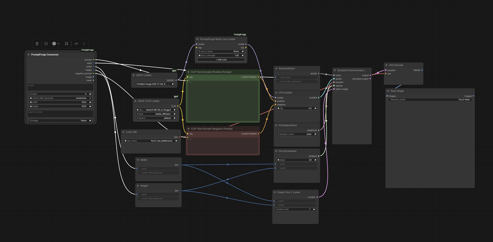

# PromptForge Connection

A ComfyUI custom node package + HTTP bridge for the
[PromptForge](https://github.com/SirZavod/PromptForge/tree/main#connecting-to-comfyui) desktop app.

**The workflow** (once this package is installed):

1. Open ComfyUI in your browser, build your graph, place a
   **PromptForge Connector** node in it (and, optionally, a
   **PromptForge Multi Lora Loader** and the three **PromptForge
   Diffusion / Clip / VAE Loaders**).
2. Open PromptForge, check "ComfyUI connected?".
3. That's it — generate from PromptForge. No file exports, no manual steps.

The JS extension pushes the live canvas graph to the PromptForge app
automatically every time you change anything, including switching
workflows in the browser.

**What PromptForge patches.** Through these nodes it switches the
diffusion model, text encoder, VAE and the text encoder's `type`; through
the Connector it sends the prompt, negative prompt, seed, size, Steps and
CFG. Sampler and Scheduler need no node of their own: PromptForge writes
them into the widgets of the graph's stock sampler node. Every value is
patched only when the active model preset (or the Builder's Sampling
card) actually sets it — an empty field leaves your graph exactly as it
is.

---


## Installation

Open your terminal in the `ComfyUI/custom_nodes` folder and run the following command. It will automatically clone the repository and create the `PromptForge` directory:

```bash
git clone https://github.com/SirZavod/PromptForge-Nodes.git PromptForge
```
## ⚠️ Important: generation always targets the *last active* workflow

PromptForge does **not** know about "tabs" or "which workflow you meant."
The bridge keeps exactly one cached graph, server-side, and every push
overwrites it — last write wins, globally, for the whole ComfyUI server.

What that means in practice:

- Whichever workflow tab you had **selected last** in the ComfyUI browser
  window is the one PromptForge will submit to — even if you've since
  closed that tab, or closed the browser entirely. The push already
  happened; the cached graph doesn't need the browser to stay open.
- Got two (or more) workflows open with a Connector node in each — say
  one wired into an **Anima** graph and one into a **Klein** graph? Switch
  to the Klein tab in the browser for a second (even without touching
  anything — just clicking the tab is enough to make it the active one),
  then go back to PromptForge: your next generation goes to Klein. Switch
  back to Anima's tab, and it goes to Anima again.
- This applies to **everything** patched onto the graph, not just the
  prompt/seed/resolution — LoRA Manager selections submit against
  whichever workflow is currently cached, so if you flip workflows without
  noticing, your LoRAs apply to a different model/graph than you expect.
- We'll ship example workflow JSONs (Anima, Klein, Z-Image Turbo) wired up
  with the Connector node so this is easy to see in practice rather than
  just read about. `ModelsPromptForge.json` is a fourth example that uses
  the PromptForge model loaders and the Connector's `steps`/`cfg` outputs.

**Rule of thumb:** before generating, glance at which ComfyUI tab/workflow
was open last — that's where the job is going.

---

## How it works

### Python side (`nodes.py`)

Four responsibilities:

1. **`PromptForgeConnection` node** — pure passthrough. Inputs
   (`prompt`, `seed`, `width`, `height`, `negative_prompt`, `image`,
   `steps`, `cfg`) → outputs of the same types and names (plus a derived
   `mask` for the image). PromptForge finds this node by `class_type` in
   the fetched graph and patches these values before submitting to
   `/prompt` — for img2img/img2video, it first uploads the picked file to
   ComfyUI's `input/` folder (via the stock `/upload/image` route) and
   patches the resulting filename into `image`. Both `negative_prompt` and
   `image` are optional: leave `negative_prompt` unconnected for models/
   workflows that don't use one, and leave `image`/`mask` unconnected
   (and `image` at "None") for plain text2image — neither whether a
   file is picked nor whether the outputs are wired downstream affects
   whether the node runs. `steps` and `cfg` are optional too: PromptForge
   writes them only when the active model preset has a value, so an
   unwired (or preset-less) graph keeps using the sampler's own widgets.
   Wire both outputs if you use them: while they stay unconnected the
   Builder says their fields will have no effect. Works as a normal node
   for manual use too — nothing about it requires
   PromptForge to be running.

2. **`PromptForgeMultiLoraLoader` node** — applies up to 30 LoRAs
   sequentially to a model (and optionally CLIP — CLIP is only needed for
   UNET-style models; DiT models can leave it unconnected). Each slot's
   dropdown is populated from ComfyUI's own indexed LoRA list
   (`folder_paths.get_filename_list("loras")`), the exact same source
   the built-in LoRA loader uses, so names always match what the node
   actually receives at execution time. Only the first slot is visible by
   default — see the JS side below for how the rest unlock.

3. **`PromptForgeDiffusionLoader` / `PromptForgeClipLoader` /
   `PromptForgeVaeLoader` nodes** — one node per file kind, so
   PromptForge can switch the diffusion model, text encoder and VAE of a
   generation without anyone editing the workflow by hand. Each node
   exposes the same non-file widgets as the stock loader (`weight_dtype`
   for diffusion, `type` for CLIP, plus `device` when the installed
   ComfyUI version adds one) and delegates to the
   stock `UNETLoader` / `CLIPLoader` / `VAELoader` at execution time.
   Diffusion and CLIP lists also include `.gguf` files and dispatch to
   the [ComfyUI-GGUF](https://github.com/city96/ComfyUI-GGUF) pack's
   `UnetLoaderGGUF` / `CLIPLoaderGGUF` when it is installed; without that
   pack the `.gguf` files simply are not listed, and executing one raises
   a readable error instead of failing deep inside ComfyUI. File lists are
   the union of the folders ComfyUI registers (`diffusion_models` + the
   legacy `unet`, `clip` + `text_encoders`, `vae`), cached server-side
   until PromptForge asks for a refresh.

4. **HTTP bridge routes**, registered on the ComfyUI server:

   | Route | Method | Role |
   |---|---|---|
   | `/promptforge/graph` | `POST` | Receives graph snapshots pushed by the JS extension |
   | `/promptforge/graph` | `GET`  | Returns the latest snapshot to PromptForge |
   | `/promptforge/loras` | `GET`  | Returns the list of LoRA files ComfyUI currently sees, for PromptForge's LoRA Manager dropdowns and library bindings |
   | `/promptforge/output_dir` | `GET` | Returns ComfyUI's real `output/` directory, so PromptForge's "Open folder" / Gallery "reveal in explorer" can point at the actual files instead of guessing |
   | `/promptforge/models` | `GET` | Returns the file list for one model kind (`?kind=diffusion`, `clip` or `vae`), for the Settings model editor. `&refresh=1` drops the server-side cache so a newly added file appears without restarting ComfyUI |
   | `/promptforge/info` | `GET` | Returns the pack name, version and the class types it provides, so the app can disable new controls on an older pack instead of failing a generation |

`/promptforge/models` only lists **files**. The text encoder `type`,
sampler and scheduler values are read from ComfyUI's own `/object_info`
(the stock `CLIPLoader` / `KSampler` definitions), so they need no route
here and no pack upgrade.

### Browser side (`web/promptforge_bridge.js`)

Loaded automatically by ComfyUI as a frontend extension. It:
- Calls `app.graphToPrompt()` (ComfyUI's own serializer) to get the
  current canvas graph in API format on every meaningful change (node
  add/remove, link change, widget edit, workflow load, before every
  queued prompt).
- POSTs the result to `/promptforge/graph`.

This means PromptForge always has the live state of whatever graph was
most recently active in the browser — no manual "Export (API)" step, no
saved JSON file.

### Browser side (`web/promptforge_lora_ui.js`)

`PromptForgeMultiLoraLoader` exposes all 30 LoRA slot pairs as inputs so
the Python side can support that many, but a node with 30 pairs of
widgets visible at once would be unusable. This extension:
- Hides every slot beyond the first on node creation.
- Adds a **"+ Add Lora"** button that reveals the next slot.
- Adds a 🗑 delete button on every slot except the first, which removes
  that slot, shifts everything above it down by one, and re-hides the
  freed slot at the end.
- Re-derives which slots should be visible from the actual widget values
  whenever a saved workflow is loaded (slot visibility is UI-only state,
  not part of the saved graph).

`MAX_SLOTS` in this file must stay in sync with `LORA_SLOTS` in
`nodes.py` (currently 30).

---

## Install

Copy the whole node package folder into `ComfyUI/custom_nodes/`:

```
ComfyUI/custom_nodes/PromptForge/
├── __init__.py
├── nodes.py
├── web/
│   ├── promptforge_bridge.js
│   └── promptforge_lora_ui.js
├── workflows/
│   ├── AnimaPromptForge.json
│   ├── Klein9bPromptForge.json
│   ├── ZITPromptForge.json
│   └── ModelsPromptForge.json
├── tests/
│   └── test_session70_nodes.py
├── pyproject.toml
└── README.md
```

Restart ComfyUI, then **reload the browser tab** (the JS extensions load
at page load time). The nodes appear under:
- **Add Node → PromptForge → PromptForge Connector**
- **Add Node → PromptForge → PromptForge Multi Lora Loader**
- **Add Node → PromptForge → PromptForge Diffusion Loader**
- **Add Node → PromptForge → PromptForge Clip Loader**
- **Add Node → PromptForge → PromptForge VAE Loader**

For `.gguf` diffusion/CLIP files, also install
[ComfyUI-GGUF](https://github.com/city96/ComfyUI-GGUF). No other extra
Python packages required — everything used (`aiohttp`, `folder_paths`,
`comfy.sd`, `comfy.utils`) ships with ComfyUI itself.

This is package version **1.2.1**. `GET /promptforge/info` reports it
together with the provided class types, so PromptForge can tell an older
pack apart and disable the newer controls instead of erroring.

---

## Wire your graph

### PromptForge Connector

| Output | Wire to |
|---|---|
| `prompt` | Positive `CLIPTextEncode` → `text` input |
| `negative_prompt` | Negative `CLIPTextEncode` → `text` input |
| `seed`   | `KSampler` → `seed` input |
| `width`  | `EmptyLatentImage` → `width` input |
| `height` | `EmptyLatentImage` → `height` input |
| `image`  | For img2img/img2video: whatever your graph's image consumer is (e.g. a `VAEEncode`'s `pixels` input, or an img2video node's image input). Leave unconnected for plain text2image. |
| `mask`   | Optional, for inpainting-style graphs that need it. |
| `steps`  | `KSampler` → `steps` input. Optional; leave unconnected to keep the sampler's own value. |
| `cfg`    | `KSampler` → `cfg` input. Optional; leave unconnected to keep the sampler's own value. |

Make sure your graph has a **SaveImage** node — that's how PromptForge
finds the result image after generation.

**Only one PromptForge Connector per graph.** For img2img/img2video,
you don't need a separate stock `LoadImage` node at all — PromptForge
uploads your chosen file straight into this same Connector's `image`
widget before every submission, the same way it already patches
`prompt`/`seed`/`negative_prompt`. You also don't need to pick anything
in the `image` dropdown by hand unless you're testing the graph
manually in the browser — PromptForge overwrites it regardless.

### Sampling (Steps / CFG / Sampler / Scheduler)

These need no extra node: PromptForge patches the graph it already
fetches.

- **Steps / CFG** can come from the Connector's `steps` / `cfg` outputs
  (outputs 7 and 8). Wire them to the sampler's own inputs. While they
  stay unconnected the generation still runs and the sampler keeps its
  values; the Builder's Sampling card says the field will have no effect.
- **Sampler / Scheduler** are written straight into the sampler's
  `sampler_name` / `scheduler` widgets. There are no Connector outputs for
  them, and no new pack version is involved — they belong to stock
  ComfyUI.
- Exactly one sampler node is patched, counting `KSampler` and
  `KSamplerAdvanced` together. If the workflow has two or more of either
  (a Wan high/low-noise pair, for example), those fields are left
  untouched and PromptForge shows a note naming the classes.
- A widget fed by a link is never overwritten: that field is skipped with
  a note, so a hand-wired graph is never silently rewritten.

### PromptForge model loaders (optional)

Use them instead of the stock model loaders if you want PromptForge's
model editor to switch files for you:

```
PromptForge Diffusion Loader → model ──▶ (Multi Lora Loader) ──▶ KSampler
PromptForge Clip Loader      → clip  ──▶ CLIPTextEncode
PromptForge VAE Loader       → vae   ──▶ VAEDecode
```

A stock loader still works fine — PromptForge simply has nothing to patch
in that graph, and your manual selection is used. `weight_dtype`
(diffusion) and `device` stay exactly what you set, just like on the stock
nodes. `type` (CLIP) is patched as well, but only when the active model
preset sets a text-encoder type; otherwise your value stays. The type list
comes from ComfyUI's own `CLIPLoader`, so it matches what the stock node
accepts.

With a **GGUF** text encoder the `CLIPLoaderGGUF` node may accept a
narrower set of types than the stock loader: a type that passes ComfyUI's
validation can still fail while the graph executes. That error comes from
ComfyUI, and the fix is to pick a type your GGUF loader actually accepts —
PromptForge does not guess on your behalf.

`ModelsPromptForge.json` in `workflows/` wires all three loaders into an
Anima graph, with the Connector's `steps`/`cfg` outputs driving the
KSampler. It is the reference example for a preset-driven graph.

### PromptForge Multi Lora Loader (optional)

Drop it between your checkpoint/model loader and the rest of the graph:

```
CheckpointLoader → model ──▶ PromptForge Multi Lora Loader → model ──▶ KSampler
                  → clip  ──▶ (optional)                   → clip  ──▶ CLIPTextEncode
```

Leave `clip` unconnected for DiT-style models that don't train CLIP
weights in their LoRAs. Pick `None` in any slot's dropdown to leave it
empty — PromptForge's LoRA Manager (and its auto-fill-from-library
feature) drives these slots directly when connected.

That's the entire setup. Subsequent workflow switches (opening a
different `.json`, or just clicking a different open tab — see the
warning above) are picked up automatically, as long as the browser tab
stays reachable by the ComfyUI server.

---

## Manual use (without PromptForge)

All nodes work like any other ComfyUI node: type a prompt, set seed /
resolution, pick models and LoRAs, queue normally. Nothing about them
requires PromptForge to be running or even installed.

---

## Field reference

### PromptForge Connector

| Field    | Type              | Range                   | Notes |
|---|---|---|---|
| `prompt` | STRING (multiline) | —                       | Overwritten by PromptForge on submit |
| `negative_prompt` | STRING (multiline) | —             | Overwritten by PromptForge on submit. Optional — leave unconnected if unused |
| `seed`   | INT               | 0 – 4 294 967 295       | Overwritten by PromptForge on submit (already resolved) |
| `width`  | INT               | 64 – 8 192 (step 8)     | Overwritten by PromptForge on submit |
| `height` | INT               | 64 – 8 192 (step 8)     | Overwritten by PromptForge on submit |
| `image`  | COMBO (input/ files) | `"None"` to skip    | Overwritten by PromptForge on submit for img2img/img2video. Optional — leave "None" for plain text2image |
| `steps`  | INT               | 1 – 10 000              | Overwritten by PromptForge when the active model has Steps. Optional |
| `cfg`    | FLOAT             | 0.0 – 100.0 (decimals ok) | Overwritten by PromptForge when the active model has CFG. Optional |
| `mask`   | MASK (output only)  | —                      | Derived from the image's alpha channel |

### PromptForge Multi Lora Loader

| Field | Type | Range | Notes |
|---|---|---|---|
| `model` | MODEL | — | Required |
| `clip` | CLIP | — | Optional — only needed for UNET-style models |
| `lora_N_name` | COMBO | indexed LoRA list, `"None"` to skip | Up to 30 slots, only slot 1 visible by default |
| `lora_N_strength` | FLOAT | -16.0 – 16.0 | Applied identically to both UNET and CLIP patching |

### PromptForge Diffusion / Clip / VAE Loaders

| Field | Type | Notes |
|---|---|---|
| `diffusion_model` | COMBO (`diffusion_models` + `unet` + `unet_gguf`) | Overwritten by PromptForge when the active model preset has one. `.gguf` needs ComfyUI-GGUF |
| `weight_dtype` | COMBO (same options as `UNETLoader`) | Never patched by PromptForge. Ignored for `.gguf` |
| `device` | COMBO (only when the stock loader has it) | Never patched by PromptForge |
| `clip` | COMBO (`clip` + `text_encoders` + `clip_gguf`) | Overwritten by PromptForge when the active model preset has one. `.gguf` needs ComfyUI-GGUF |
| `type` | COMBO (same options as `CLIPLoader`) | Overwritten by PromptForge only when the active model preset sets a text encoder type |
| `vae` | COMBO (`vae`) | Overwritten by PromptForge when the active model preset has one |

---

## Release notes

### 1.2.1
- Documentation only: the `type` widget of **PromptForge Clip Loader** is
  now described as "patched by PromptForge only when the active model
  preset sets it" instead of "never patched". Behaviour is unchanged from
  1.2.0.

### 1.2.0
- New **PromptForge Diffusion Loader**, **PromptForge Clip Loader** and
  **PromptForge VAE Loader**, with `.gguf` support through ComfyUI-GGUF.
- The Connector gained `steps` and `cfg` outputs. They were appended after
  `mask`, so workflows saved with 1.1.0 keep their widget order and load
  unchanged.
- New `/promptforge/models` route (file lists for Settings) and the
  `ModelsPromptForge.json` example.
- The Clip Loader's `type` list is taken from the stock `CLIPLoader`.

### 1.1.0
- **PromptForge Connector** and **PromptForge Multi Lora Loader**, the
  HTTP bridge (`/promptforge/graph`, `/promptforge/loras`,
  `/promptforge/output_dir`), the two JS extensions and the Anima /
  Klein / Z-Image Turbo example workflows.

---

## License

Public domain — [The Unlicense](https://unlicense.org/).
